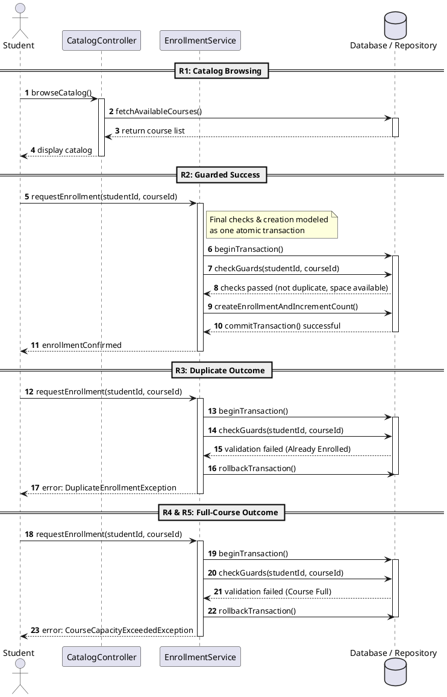
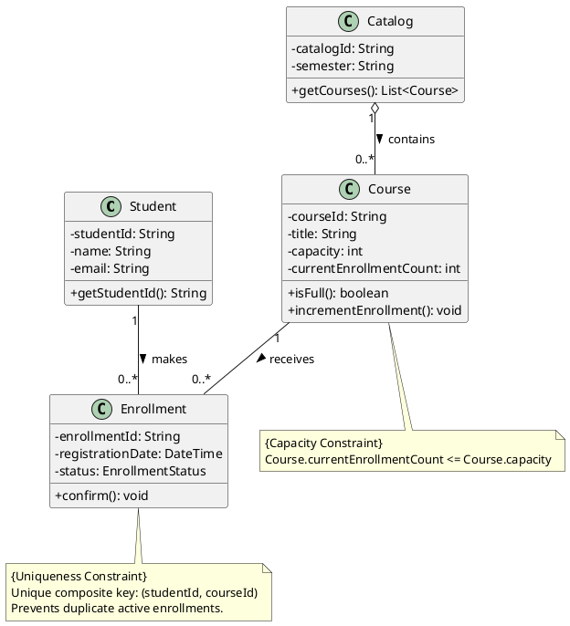
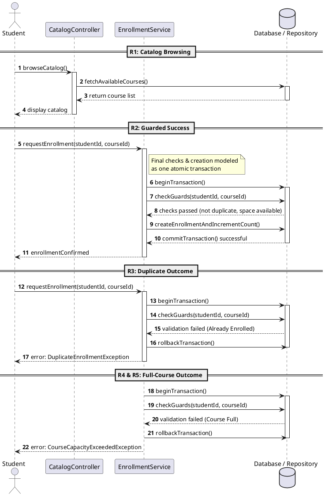
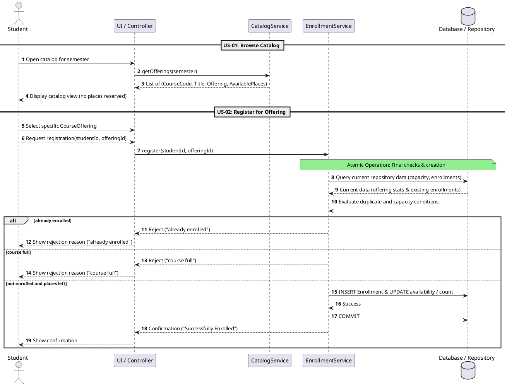
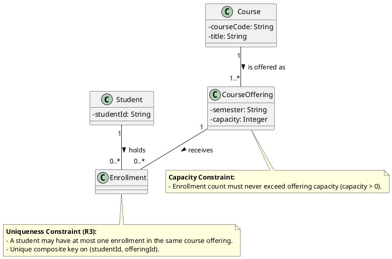

# SIS #02 — AI-Assisted UML Modeling: University Course Registration

<!--
  This is the only file you write your report in. README.md tells you what goes where.

  Rules the checker relies on:
  - Do not delete, rename or renumber the ## headings, the ### headings, or the **Label:** words.
  - Replace every "(write here)" and "(paste here)". None may be left when you submit.
  - Comments like this one are ignored by the checker and the word counter. Delete them or leave them.
-->

## 1. Scope and assumptions

<!-- Your FINAL scope statement and assumptions, after reviewing Prompt A's output. Say here
     what is out of scope (payments, prerequisites, timetable clashes, waiting lists,
     cancellation) — section 2 must not mention them. Section 10 keeps your first version. -->

**Scope:** The system allows signed-in students to browse course offerings for a selected semester and register for a specific offering. It displays course codes, titles, offerings, and available places. During registration, the system checks current availability and prevents duplicate enrollments and registrations that exceed capacity. Successful requests create one Enrollment and return confirmation. Rejected requests explain whether the offering is full or the student is already enrolled. Payments, prerequisites, timetable clashes, waiting lists, and cancellation are out of scope.

**Assumptions:**

1. The student is already signed in, and the selected course offering exists in the system.
2. Each course offering has a positive integer capacity, and the system can determine the current number of enrolled students.

## 2. User stories and acceptance criteria

<!-- Your APPROVED requirements: Prompt A's draft after your review. Keep the IDs, the three
     story headings and the bullet shape. Every criterion names the rule(s) it maps to,
     e.g. (R2, R4). Two criteria per story. Nothing out of scope.
     Format of a criterion, on one bullet:
     - **AC-03** (R2, R4): Given ..., When ..., Then ... -->

### US-01 — Browse offerings

**US-01:** As a signed-in student, I want to browse course offerings for a semester, so that I can see course codes, titles, offerings, and available places.

- **AC-01** (R1): Given the student is signed in and opens the catalog for a semester, When the catalog loads, Then the system shows the course code, title, offering, and available places.
- **AC-02** (R2): Given the student is viewing an offering in the catalog, When the student views its available places without submitting a registration request, Then no place is reserved for the student.

### US-02 — Register for an offering

**US-02:** As a signed-in student, I want to register for an offering with available places, so that I can enroll and receive confirmation.

- **AC-03** (R2, R4): Given the student is signed in and an existing offering has available places, When the student requests registration and the current availability is verified, Then the system creates exactly one Enrollment linking the student and offering, updates the available places count, and returns confirmation.
- **AC-04** (R2, R4): Given multiple students request the last available place at the same time, When the system performs the final availability checks and creates an enrollment, Then these actions execute atomically so that the capacity cannot be exceeded.

### US-03 — Receive a clear rejection

**US-03:** As a signed-in student, I want to receive a clear reason when registration is rejected, so that I understand why I could not enroll and my enrollment status remains unchanged.

- **AC-05** (R2, R5): Given an offering has no available places, When the student requests registration and the system rechecks availability, Then the system rejects the request with the reason "course full", creates no Enrollment, and leaves the enrollment count unchanged.
- **AC-06** (R3, R5): Given the student is already enrolled in the target offering, When the student requests registration for that same offering again, Then the system rejects the request with the reason "already enrolled", creates no Enrollment, and leaves the enrollment count unchanged.

## 3. Sequence diagram

<!-- The FINAL diagram, rendered. Change .png to .svg if that is what you exported. -->


**Participants:** Student is the signed-in user who browses the catalog, selects a specific course offering, and requests registration.

CatalogController handles the catalog request, retrieves course offerings for the selected semester, and displays them to the student.

EnrollmentService coordinates registration, evaluates duplicate and capacity conditions using current repository data, and decides whether the request can succeed.

Database / Repository retrieves current offering and enrollment data and participates in the transaction that creates an enrollment or rolls back a rejected request

**Atomic operation:** The atomic operation begins with beginTransaction() and includes fetchCurrentOfferingData(offeringId), evaluation of the duplicate and capacity conditions, and the appropriate outcome. If the student is already enrolled, the service rolls back and returns already enrolled. If the offering is full, it rolls back and returns course full. Otherwise, it creates the enrollment, updates the enrollment count, and commits the transaction before returning confirmation. These final checks and updates must be atomic so that concurrent requests cannot exceed capacity. Browsing the catalog only displays availability at that moment; it does not reserve a place.

**Where the Enrollment is created:** In the success branch, EnrollmentService sends createEnrollment(studentId, offeringId) to Database / Repository. This operation creates one Enrollment linking the selected Student and CourseOffering from the class diagram. The service then updates the enrollment count and commits before returning confirmation.

**Technical lifelines:** CatalogController, EnrollmentService, and Database / Repository are technical lifelines, not additional domain classes in the class diagram. The sequence diagram describes how the system components collaborate over time, while the class diagram focuses on the domain concepts Student, Course, CourseOffering, and Enrollment. The different abstraction levels are intentional: the controller handles catalog interaction, the service coordinates registration rules, and the repository provides data access and transaction operations.


## 4. Class diagram

<!-- The FINAL diagram, rendered. -->


<!-- One row per association in classes.puml, read in both directions. -->

| Association | Read left to right | Read right to left |
| --- | --- | --- |
| Student "1" -- "0..*" Enrollment : holds > | One Student can hold zero or many Enrollment records. | Each Enrollment belongs to exactly one Student. |
| CourseOffering "1" -- "0..*" Enrollment : receives > | One CourseOffering can receive zero or many Enrollment records. | Each Enrollment targets exactly one CourseOffering. |
| Course "1" -- "1..*" CourseOffering : is offered as > | One Course can be offered through one or many CourseOffering instances. | Each CourseOffering describes exactly one Course |

**How an Enrollment links a student to an offering:** Each Enrollment connects exactly one Student to exactly one CourseOffering. This means that registration is for a specific scheduled offering, not merely for a general Course. The same student may enroll in multiple different offerings, but the uniqueness constraint prevents that student from registering more than once for the same offering.

**Capacity constraint:** CourseOffering.currentEnrollmentCount <= CourseOffering.capacity

The current enrollment count must never exceed the capacity of the offering. Multiplicity alone cannot express this numerical limit because it describes how many objects may be associated, not a comparison between the number of Enrollment records and the capacity attribute. The registration operation must recheck current availability before creating an Enrollment.

**Uniqueness constraint:** The combination (studentId, offeringId) must be unique for Enrollment records. This prevents a student from having duplicate registrations for the same CourseOffering while still allowing registration for other offerings. Multiplicity alone cannot express this restriction because it does not prevent two Enrollment records from linking the same Student to the same CourseOffering.

## 5. Traceability

<!-- Every rule, including the catalog fields and availability (R1). Column 1: the rule and
     the criteria that cover it, e.g. "R2 + AC-03, AC-04". Column 2: the message, guard,
     class or constraint that shows the rule in YOUR diagrams. Column 3: the T-ID that
     exercises it, or the extra check you did instead (R1 has no T case). -->

| Rule and criterion | Model evidence | Validation case |
| --- | --- | --- |
| R1 + AC-01, AC-02 | Sequence: browseCatalog(semester), fetchCourseOfferings(semester) and catalog display; Class diagram: Course code/title and CourseOffering semester. | Extra check: verify that the catalog shows course code, title, offering and available places, and that browsing alone does not reserve a place. |
| R2 + AC-03, AC-04, AC-05 | Sequence: fetchCurrentOfferingData(offeringId), capacity guard, atomic creation and count update; Class diagram: CourseOffering capacity and current enrollment count constraint. | T1, T2, T3 |
| R3 + AC-06 | Sequence: already enrolled alternative; Class diagram: uniqueness constraint on (studentId, offeringId). | T4 |
| R4 + AC-03, AC-04 | Sequence: createEnrollment(studentId, offeringId), incrementEnrollmentCount(offeringId), transaction commit, then confirmation; Class diagram: Enrollment associations to Student and CourseOffering. | T1, T2 |
| R5 +  AC-05, AC-06 | Sequence: course full and already enrolled rejection alternatives; both rejection paths roll back, return a reason and leave the count unchanged. | T3, T4 |

## 6. Walkthroughs

<!-- Walk each case through YOUR final sequence diagram, message by message. Column 2: the
     actual steps and the state change (count before → after). Column 3 starts with Pass or
     Fail, then the location: the message, guard or note where you saw it. A Fail you
     report honestly is a finding, not a penalty. -->

| Case | Observed path and state change | Judgment and evidence |
| --- | --- | --- |
| T1. Available | The student browses the catalog, selects an offering, and requests registration. The service checks current data, finds no duplicate and available capacity, creates one Enrollment, updates the count from 0 to 1, and commits. | Pass — not enrolled and places left branch; createEnrollment, incrementEnrollmentCount, and commitTransaction. |
| T2. Last place | place	The student selects an offering with capacity 2 and current count 1. The service rechecks current data, finds no duplicate and one place left, creates one Enrollment, and updates the count from 1 to 2. | Pass — not enrolled and places left branch; capacity note and creation/update messages. |
| T3. Full | The catalog previously displayed an available place, but the current count has reached capacity 2 of 2. The service fetches current offering data, rejects the request, rolls back, creates no Enrollment, and leaves the count at 2. | Pass — course full branch; fetchCurrentOfferingData, rollbackTransaction, and rejection response. |
| T4. Duplicate | A student already enrolled in the offering submits another request while the count is 1 of 2. The service detects the existing enrollment, rolls back, creates no additional Enrollment, and leaves the count at 1. | Pass — already enrolled branch; duplicate guard, rollbackTransaction, and rejection response. |

## 7. Review decisions

<!-- At least three substantive decisions about Prompt C's critique or your own inspection.
     Decision: accepted / rejected / modified — and what you did. Reason: why, in a full
     sentence. Rule: R1–R5. Do not invent an error to fill the table; a justified rejection
     of advice counts. -->

| AI suggestion or model element | Decision | Reason | Rule |
| --- | --- | --- | --- |
| Add an EnrollmentStatus lifecycle with Pending and Confirmed states. | Rejected | The assignment requires creating one Enrollment and returning confirmation, but it does not define enrollment statuses or lifecycle transitions, so adding them would expand the agreed scope. | R4 |
| Make the stale-catalog rejection and the successful last-place registration explicit. | Accepted | A catalog view does not reserve a place, so registration must use current availability; T2 and T3 demonstrate the required boundary and rejection behavior. | R2, R4, R5 |
| Evaluate duplicate and capacity guards using current repository data inside the atomic registration operation. | Accepted | Current data must be checked immediately before creation, and the checks and creation must be atomic to prevent duplicate enrollment and capacity from being violated by concurrent requests. | R2, R3, R4 |

## 8. Modeling explanation

<!-- 200–300 words. Your main design choices; how the class diagram and the sequence diagram
     complement each other; why an activity diagram could also help explain the workflow. -->

The two UML diagrams describe different aspects of the course registration system. The class diagram shows the main domain concepts and the relationships between them. Student represents the person who registers for courses. Course describes a subject by its code and title. CourseOffering represents a specific scheduled offering in a semester and stores its capacity and current enrollment count. Enrollment connects one student to one specific offering.

This distinction between Course and CourseOffering is important. A course can be offered in multiple semesters or sections, and each offering can have a different capacity. Therefore, an enrollment must refer to CourseOffering rather than only to Course. The multiplicities show that a student can have many enrollment records, while each Enrollment belongs to exactly one Student and one CourseOffering. The capacity and uniqueness constraints express additional rules that multiplicities alone cannot describe.

The sequence diagram explains how the registration request proceeds over time. The student first browses the catalog and selects an offering. When the student requests registration, EnrollmentService retrieves current repository data and checks whether the student is already enrolled and whether a place remains. If the offering is full or the student is already enrolled, the system rejects the request without creating another Enrollment or changing the count. Otherwise, it creates the enrollment, updates availability, commits the transaction, and returns confirmation.

The atomic operation is essential because two students could request the final place at nearly the same time. The final checks and creation must be treated as one operation so that capacity is not exceeded. An activity diagram could complement these models by showing the decision flow from catalog browsing through validation, rejection or successful registration. It would make the workflow easier to follow, while the class diagram would still describe the domain structure.

## 9. Reflection

<!-- 150–200 words. Written by you, not by the assistant: where AI helped, one decision you
     made yourself, one remaining limitation. Specific beats flattering. -->

Gemini helped me create the first versions of the sequence and class diagrams. It also helped me find problems in the models and suggest corrections. For example, the AI pointed out that the sequence diagram should show what happens when a student sees an available place in the catalog, but the course becomes full before registration. This helped me understand why the system must check the current availability again.

One important decision I made myself was to reject the suggestion to add an EnrollmentStatus attribute and a status lifecycle. I decided not to include them because the assignment does not require different enrollment statuses.  These cases are important because the system must not exceed the capacity or create duplicate enrollments.

One limitation of my models is that they describe the expected behavior but do not prove that the implementation will work correctly with simultaneous requests. I also learned that AI suggestions must be checked against the original requirements. A suggestion can look reasonable but still introduce unnecessary details or features that are outside the scope of the assignment.

## 10. Appendix A — Before AI

<!-- Written BEFORE you run Prompt A, committed and pushed in your first commit, and never
     edited afterwards. This is what you paste into Prompt A as "My initial assumptions". -->

**Scope:** The system allows signed-in students to browse course offerings for a semester, check available places, and register for an offering while preventing registrations that exceed capacity or duplicate an existing enrollment.

**Initial assumptions:**

1. The student is already signed in, and the selected course offering exists in the system.
2. Each course offering has a positive integer capacity, and the system can determine the current number of enrolled students.

## 11. Appendix B — AI exchanges

<!-- Complete prompts and complete responses, as text — never screenshots. Paste each inside
     the ~~~~ block that follows its label: AI responses contain ``` PlantUML blocks, and
     ~~~~ keeps them from breaking this file. Prompts B and C: the prompt text first, then
     the material it refers to ("below", "these two") pasted under it, in the same block.
     You may add B5, B6 … after B4 if you ran more. -->

### B1 — Requirements (Prompt A)

- **Tool:** Gemini
- **Model:** Gemini 3.6 Flash
- **Date:** 2026-10-15
- **Purpose:** draft 3 user stories and 6 acceptance criteria

<!-- Model: the exact model with its version, as the tool shows it (e.g. "GPT-5 Thinking",
     "Claude Sonnet 4.5"). If the tool does not show it, write: not displayed
     Date: YYYY-MM-DD -->

**Prompt:**

~~~~text
Act as a requirements analyst. Use only this course registration scenario and rules R1–R5: 

A student browses an electronic course catalog, chooses a course offering and requests registration. Each offering has a limited number of places.

A Course describes a subject. A CourseOffering is one scheduled section in one semester. Registration always targets a specific offering.

Assume that the student is signed in, the selected offering exists, and its capacity is a positive whole number.

R1. Catalog: Show the course code, title, offering and available places for one semester.

R2. Capacity: Recheck current availability when registering. Enrollment must never exceed the offering's capacity.

R3. Duplicates: A student may have at most one enrollment in the same offering. Reject a repeat request.

R4. Success: Create exactly one Enrollment linking the student and offering, update availability and return a confirmation.

R5. Rejection: Explain "course full" or "already enrolled". Create no enrollment and leave the enrollment count unchanged.

These rules define this assignment. A catalog view does not reserve a place. Model the final checks and enrollment creation as one atomic operation so competing requests cannot take the same last place. A note describing the atomic operation is sufficient; database implementation is outside this assignment.

Exclude payments, prerequisites, timetable clashes, waiting lists and cancellation. Use fictional students and courses.

My initial assumptions are:
1. The student is already signed in, and the selected course offering exists in the system.
2. Each course offering has a positive integer capacity, and the system can determine the current number of enrolled students.

Draft 3 user stories and 2 Given / When / Then acceptance criteria for each. Use IDs US-01 to US-03 and AC-01 to AC-06. Map each criterion to rule IDs.
Cover normal and rejection behavior. List uncertainty separately. Do not add excluded features or invent university policies.
~~~~

**Response:**

~~~~text
Here is the requirements analysis, structured into user stories, acceptance criteria mapped to the rules, and a separate list of uncertainties based strictly on your scenario and rules.

---

## User Stories & Acceptance Criteria

### US-01: Course Catalog Browsing

**As a** signed-in student,

**I want to** browse the electronic course catalog for a specific semester,

**So that I can** view course codes, titles, available offerings, and their current available places.

* **AC-01: Display Catalog Information**
* **Given** the student is signed in and opens the electronic course catalog for a semester,
* **When** the catalog page loads,
* **Then** the system shows the course code, title, offering, and available places for one semester.
* **Rule Mapping:** R1


* **AC-02: Non-Reservation Nature of Catalog View**
* **Given** a student is viewing the available places for a course offering in the catalog,
* **When** the student browses or views the catalog details without submitting a registration request,
* **Then** no place is reserved or held for the student.
* **Rule Mapping:** R1 (Scenario Constraint)


---

### US-02: Successful Course Registration

**As a** signed-in student,

**I want to** request registration for an existing course offering with available places,

**So that** I am successfully enrolled and receive a confirmation.

* **AC-03: Successful Enrollment Creation**
* **Given** a student is signed in and selects an existing course offering with a positive number of available places,
* **When** the student requests registration and availability is successfully verified,
* **Then** the system creates exactly one Enrollment linking the student and offering, updates the available places count, and returns a confirmation.
* **Rule Mapping:** R2, R4


* **AC-04: Atomic Operation for Competing Requests**
* **Given** multiple students simultaneously request registration for the last remaining place in a course offering,
* **When** the system executes the final availability rechecks and enrollment creation,
* **Then** the process executes as a single atomic operation so that competing requests cannot take the same last place.
* **Rule Mapping:** R2, R4


---

### US-03: Registration Rejections

**As a** signed-in student,

**I want the system to** reject my registration request if the course is full or if I am already enrolled,

**So that I receive** a clear explanation and my enrollment status remains unchanged.

* **AC-05: Rejection Due to Full Capacity ("Course Full")**
* **Given** a student requests registration for an offering where the enrollment count equals or exceeds capacity,
* **When** the system rechecks availability during the atomic registration request,
* **Then** the system rejects the request, explains "course full", creates no enrollment, and leaves the enrollment count unchanged.
* **Rule Mapping:** R2, R5


* **AC-06: Rejection Due to Duplicate Enrollment ("Already Enrolled")**
* **Given** a student already has an existing enrollment in the target course offering,
* **When** the student submits another registration request for the same offering,
* **Then** the system rejects the request, explains "already enrolled", creates no enrollment, and leaves the enrollment count unchanged.
* **Rule Mapping:** R3, R5


---

## Uncertainties and Ambiguities

* **Confirmation Format:** Rule R4 mandates returning a "confirmation" upon success, but does not define its specific delivery mechanism (e.g., UI banner, modal dialog, or notification badge) or structural contents.
* **Exact Error Message Strings:** Rule R5 requires explaining "course full" or "already enrolled", but does not specify whether these exact strings must be used verbatim or if capitalization/punctuation flexibility is permitted.
* **Atomic Operation Implementation Details:** While a note describing the atomic operation is accepted and database-level implementation is excluded, the precise application-layer isolation level or locking mechanism to guarantee atomicity is unspecified.
~~~~

### B2 — UML drafts (Prompt B)

- **Tool:** Gemini
- **Model:** Gemini 3.6 Flash
- **Date:** 2026-10-15
- **Purpose:** draft the sequence and class diagrams

**Prompt:**

~~~~text
Using my approved scenario, R1–R5, stories and criteria below, return separate PlantUML code blocks for a sequence diagram and a domain class diagram.
Sequence: include catalog browsing and guarded success, full-course and duplicate outcomes. Model final checks and creation as one atomic operation.
Class: show domain concepts, useful attributes and multiplicities. State the capacity and uniqueness constraints. Explain assumptions and any technical lifelines.
Approved scenario and rules
A student browses an electronic course catalog, chooses a course offering and requests registration. Each offering has limited places.
A Course describes a subject. A CourseOffering is one scheduled section in one semester. Registration always targets a specific offering.
Assumptions:
1. The student is already signed in, and the selected course offering exists in the system.
2. Each course offering has a positive integer capacity, and the system can determine the current number of enrolled students.
R1. Catalog: Show the course code, title, offering and available places for one semester.
R2. Capacity: Recheck current availability when registering. Enrollment must never exceed the offering's capacity.
R3. Duplicates: A student may have at most one enrollment in the same offering. Reject a repeat request.
R4. Success: Create exactly one Enrollment linking the student and offering, update available places, and return confirmation.
R5. Rejection: Explain "course full" or "already enrolled". Create no enrollment and leave the enrollment count unchanged.
A catalog view does not reserve a place. Final checks and enrollment creation must be one atomic operation so competing requests cannot take the same last place.
Payments, prerequisites, timetable clashes, waiting lists and cancellation are out of scope.
Approved user stories and acceptance criteria
US-01 — Browse offerings
As a signed-in student, I want to browse course offerings for a semester, so that I can see course codes, titles, offerings, and available places.
- AC-01 (R1): Given the student is signed in and opens the catalog for a semester, When the catalog loads, Then the system shows the course code, title, offering, and available places.
- AC-02 (R1): Given the student is viewing an offering in the catalog, When the student views its available places without submitting a registration request, Then no place is reserved for the student.
US-02 — Register for an offering
As a signed-in student, I want to register for an offering with available places, so that I can enroll and receive confirmation.
- AC-03 (R2, R4): Given the student is signed in and an existing offering has available places, When the student requests registration and the current availability is verified, Then the system creates exactly one Enrollment linking the student and offering, updates the available places count, and returns confirmation.
- AC-04 (R2, R4): Given multiple students request the last available place at the same time, When the system performs the final availability checks and creates an enrollment, Then these actions execute atomically so that the capacity cannot be exceeded.
US-03 — Receive a clear rejection
As a signed-in student, I want to receive a clear reason when registration is rejected, so that I understand why I could not enroll and my enrollment status remains unchanged.
- AC-05 (R2, R5): Given an offering has no available places, When the student requests registration and the system rechecks availability, Then the system rejects the request with the reason "course full", creates no Enrollment, and leaves the enrollment count unchanged.
- AC-06 (R3, R5): Given the student is already enrolled in the target offering, When the student requests registration for that same offering again, Then the system rejects the request with the reason "already enrolled", creates no Enrollment, and leaves the enrollment count unchanged.
~~~~

**Response:**

~~~~text
Here are the sequence and domain class diagrams modeled for a standard course registration system covering catalog browsing, guarded success, duplicate and full-course outcomes, and atomic transaction handling for final validation and creation.

*Note: Since your specific textual scenario and criteria list was omitted, these diagrams are built around standard academic registration requirements (R1–R5). You can easily adjust attributes or method names to match your exact terminology.*

---

### 1. Sequence Diagram (Catalog Browsing & Enrollment Outcomes)



---

### 2. Domain Class Diagram (Concepts, Multiplicities & Constraints)



---

### Explanations & Technical Assumptions

* **Atomic Operation Lifeline:** In the sequence diagram, the final validation (capacity check and duplicate check) and the creation of the enrollment record are wrapped within a single database transaction (`beginTransaction()` through `commitTransaction()` / `rollbackTransaction()`). This prevents race conditions where two concurrent students might slip past the capacity check simultaneously.
* **Capacity Constraint:** The `Course` class enforces that `currentEnrollmentCount` never exceeds `capacity`. If an enrollment request arrives when `isFull()` evaluates to true, the transaction rolls back and triggers a full-course exception.
* **Uniqueness Constraint:** Modeled at the database and domain level via a composite uniqueness constraint on `(studentId, courseId)`, ensuring a student cannot register for the same course more than once.
~~~~

### B3 — Model critique (Prompt C)

- **Tool:** Gemini
- **Model:** Gemini 3.6 Flash
- **Date:** 2026-10-15
- **Purpose:** review both models against R1–R5 and T1–T4

**Prompt:**

~~~~text
Review these two UML models against R1–R5 and my acceptance criteria. Check message order, guards, state changes, multiplicities and naming.
Inspect the four validation cases: available places, exactly one place, full course after a stale catalog view, and duplicate registration.
For each issue, cite the affected rule and model element. Explain the impact and propose a focused correction. Separate genuine defects from optional design choices.
@startuml
skinparam classAttributeIconSize 0

class Student {
-     
studentId: String
-     
name: String
-     
email: String
    + getStudentId(): String
}

class Course {
-     
courseId: String
-     
title: String
-     
capacity: int
-     
currentEnrollmentCount: int
    + isFull(): boolean
    + incrementEnrollment(): void
}

class Enrollment {
-     
enrollmentId: String
-     
registrationDate: DateTime
-     
status: EnrollmentStatus
    + confirm(): void
}

class Catalog {
-     
catalogId: String
-     
semester: String
    + getCourses(): List<Course>
}

Catalog "1" o-- "0..*" Course : contains >
Student "1" -- "0..*" Enrollment : makes >
Course "1" -- "0..*" Enrollment : receives >

note "{Capacity Constraint}\nCourse.currentEnrollmentCount <= Course.capacity" as N1
Course .. N1

note "{Uniqueness Constraint}\nUnique composite key: (studentId, courseId)\nPrevents duplicate active enrollments." as N2
Enrollment .. N2

@enduml

@startuml
autonumber
actor Student
participant "CatalogController" as CC
participant "EnrollmentService" as ES
database "Database / Repository" as DB

== R1: Catalog Browsing ==
Student -> CC: browseCatalog()
activate CC
CC -> DB: fetchAvailableCourses()
activate DB
DB --> CC: return course list
deactivate DB
CC --> Student: display catalog
deactivate CC

== R2: Guarded Success ==
Student -> ES: requestEnrollment(studentId, courseId)
activate ES
note right of ES: Final checks & creation modeled\nas one atomic transaction
ES -> DB: beginTransaction()
activate DB
ES -> DB: checkGuards(studentId, courseId)
DB --> ES: checks passed (not duplicate, space available)
ES -> DB: createEnrollmentAndIncrementCount()
DB --> ES: commitTransaction() successful
deactivate DB
ES --> Student: enrollmentConfirmed
deactivate ES

== R3: Duplicate Outcome ==
Student -> ES: requestEnrollment(studentId, courseId)
activate ES
ES -> DB: beginTransaction()
activate DB
ES -> DB: checkGuards(studentId, courseId)
DB --> ES: validation failed (Already Enrolled)
ES -> DB: rollbackTransaction()
deactivate DB
ES --> Student: error: DuplicateEnrollmentException
deactivate ES

== R4 & R5: Full-Course Outcome ==
Student -> ES: requestEnrollment(studentId, courseId)
activate ES
ES -> DB: beginTransaction()
activate DB
ES -> DB: checkGuards(studentId, courseId)
DB --> ES: validation failed (Course Full)
ES -> DB: rollbackTransaction()
deactivate DB
ES --> Student: error: CourseCapacityExceededException
deactivate ES

@enduml
~~~~

**Response:**

~~~~text
Here is a detailed review of your Class Diagram and Sequence Diagram against standard design principles, rules **R1–R5**, and your validation cases.

---

### 1. Validation Case Analysis

* **Available places (R2):** **Pass / Well-Modeled.** The sequence diagram successfully illustrates the happy path where transaction guards pass, the enrollment is created, the course count is incremented, and the transaction commits successfully.
* **Duplicate registration (R3):** **Pass / Well-Modeled.** Correctly captures the uniqueness constraint check (`studentId, courseId`), triggering a rollback and raising a `DuplicateEnrollmentException`.
* **Exactly one place (Boundary Condition):** **Minor Defect / Gap.** While the capacity constraint note (`currentEnrollmentCount <= capacity`) exists in the class diagram, neither model explicitly demonstrates the edge case where `currentEnrollmentCount == capacity - 1` transitions to full upon enrollment, nor is there a test case verifying that the final remaining seat is successfully claimed without causing an off-by-one error.
* **Full course after a stale catalog view (R4 & R5 combined):** **Defect.** Your sequence diagram groups R4 and R5 into a single block. However, **R5 specifically represents a stale catalog view**—where a student views an open course in R1, but by the time they submit `requestEnrollment`, the course has filled up. The current sequence diagram treats R4 and R5 identically as an immediate rejection, failing to show the temporal sequence where a student acts on outdated catalog data.

---

### 2. Review of Genuine Defects vs. Optional Design Choices

#### **Defect 1: Missing State Lifecycle Transitions for Enrollment**

* **Affected Rule / Element:** Class Diagram (`Enrollment` class, `status: EnrollmentStatus`, `confirm()`) & Sequence Diagram (`ES -> DB: createEnrollmentAndIncrementCount()`).
* **Impact:** The class diagram defines an `EnrollmentStatus` and a `confirm()` method, implying a state machine or lifecycle (e.g., `Pending` -> `Confirmed`). However, the sequence diagram skips this entirely, jumping straight from creation to `enrollmentConfirmed`.
* **Correction:** Update the sequence diagram or add an explicit state change step where the enrollment is initialized with a pending/active status before confirmation.

#### **Defect 2: Blurring R4 and R5 (Stale Catalog View Handling)**

* **Affected Rule / Element:** Sequence Diagram (Blocks R4 & R5).
* **Impact:** Lumping R4 (standard capacity check) and R5 (stale view race condition) together obscures the specific system behavior required when a client caches or views stale catalog data.
* **Correction:** Split R4 and R5 into separate sequence fragments. For R5, show the timeline explicitly: Student views catalog (R1) $\rightarrow$ Course fills up externally $\rightarrow$ Student submits `requestEnrollment` using the stale view $\rightarrow$ Guard catches capacity limit $\rightarrow$ Rollback & `CourseCapacityExceededException`.

#### **Defect 3: Business Logic Encapsulation (Architectural Choice / Minor Defect)**

* **Affected Rule / Element:** Sequence Diagram (`ES -> DB: checkGuards(...)`).
* **Impact:** Delegating business guard checks (duplicate check, capacity check) directly to the `Database / Repository` layer treats business rules as pure database constraints. In layered architecture, business guards should be evaluated in the **Service or Domain layer** (`EnrollmentService`), using repository data rather than having the database return validation pass/fail states as a raw query response.
* **Correction:** Move the guard evaluation step into `EnrollmentService` (e.g., `ES` queries `DB` for state, evaluates guards locally in `ES`, and then proceeds with transaction commit or rollback). *Note: This is partially a design choice depending on whether your architecture favors an Active Record / Stored Procedure pattern or a Domain-Driven Service layer.*

---

### Summary of Recommended Actions

1. **Split R4 and R5** in the sequence diagram to explicitly depict the stale catalog race condition scenario.
2. **Incorporate enrollment status handling** to align the sequence steps with the `EnrollmentStatus` attribute defined in your class diagram.
3. **Refine guard logic placement** in the sequence diagram so that `EnrollmentService` performs the validation check rather than delegating the business rule evaluation directly to the database layer.
~~~~

### B4 — Focused revision (Prompt D)

- **Tool:** Gemini
- **Model:** Gemini 3.6 Flash
- **Date:** 2026-10-15
- **Purpose:** apply my accepted review decisions

**Prompt:**

~~~~text
Revise the UML sources using only my accepted review decisions.

Keep justified existing elements and explain each change.

Flag any unresolved issue.

## Scenario

A student browses an electronic course catalog, selects a specific CourseOffering, and requests registration. Each CourseOffering has a limited number of places. A Course describes a subject; a CourseOffering represents one scheduled section of a course in one semester; an Enrollment links one Student to one specific CourseOffering.

Assume the student is already signed in, the selected offering exists, and every offering has a positive integer capacity. Browsing the catalog does not reserve a place. The final checks and Enrollment creation must execute as one atomic operation so concurrent requests cannot exceed capacity.

Out of scope: payments, prerequisites, timetable clashes, waiting lists, cancellation, and unrelated features.

## Business rules

- R1 — Catalog: Show course code, title, offering, and available places for one semester.
- R2 — Capacity: Recheck current availability during registration. Enrollment must never exceed offering capacity.
- R3 — Duplicates: A student may have at most one Enrollment in the same CourseOffering.
- R4 — Success: Create exactly one Enrollment linking the student and offering, update availability, and return confirmation.
- R5 — Rejection: Explain either "course full" or "already enrolled". Create no Enrollment on rejection and leave the enrollment count unchanged.

## Approved user stories and acceptance criteria

### US-01 — Browse offerings

As a signed-in student, I want to browse course offerings for a semester, so that I can see course codes, titles, offerings, and available places.

- AC-01 (R1): Given the student is signed in and opens the catalog for a semester, When the catalog loads, Then the system shows the course code, title, offering, and available places.
- AC-02 (R1): Given the student is viewing an offering in the catalog, When the student views its available places without submitting a registration request, Then no place is reserved for the student.

### US-02 — Register for an offering

As a signed-in student, I want to register for an offering with available places, so that I can enroll and receive confirmation.

- AC-03 (R2, R4): Given the student is signed in and an existing offering has available places, When the student requests registration and current availability is verified, Then the system creates exactly one Enrollment linking the student and offering, updates the available places count, and returns confirmation.
- AC-04 (R2, R4): Given multiple students request the last available place at the same time, When the system performs the final availability checks and creates an enrollment, Then these actions execute atomically so that capacity cannot be exceeded.

### US-03 — Receive a clear rejection

As a signed-in student, I want to receive a clear reason when registration is rejected, so that I understand why I could not enroll and my enrollment status remains unchanged.

- AC-05 (R2, R5): Given an offering has no available places, When the student requests registration and the system rechecks availability, Then the system rejects the request with the reason "course full", creates no Enrollment, and leaves the enrollment count unchanged.
- AC-06 (R3, R5): Given the student is already enrolled in the target offering, When the student requests registration for that same offering again, Then the system rejects the request with the reason "already enrolled", creates no Enrollment, and leaves the enrollment count unchanged.

## Accepted review decisions

1. Explicitly demonstrate T2: an offering has exactly one place remaining, a new student requests registration, the request succeeds, one Enrollment is created, and the enrollment count reaches capacity without exceeding it.
2. Explicitly demonstrate T3: a student views the catalog while a place is available, another registration takes the last place, and the first student's subsequent registration request is rejected as "course full". No Enrollment is created by the rejected request and the enrollment count remains unchanged.
3. EnrollmentService evaluates duplicate and capacity conditions using current data returned by the repository. Final checks and enrollment creation must remain within one atomic operation.
4. Do not add EnrollmentStatus, status transitions, extra domain classes, or new business requirements. These are not required by the approved specification.
5. Keep justified existing elements and explain each change.
6. Flag any unresolved issue.

## Required sequence diagram

- Show catalog browsing for a semester and the displayed course code, title, offering, and available places.
- Explicitly show the student selecting a specific CourseOffering from the displayed catalog before requesting registration.
- Declare every participant before using it and name every message.
- Show the registration request before the final duplicate and capacity checks.
- Show EnrollmentService evaluating both conditions using current repository data before the alternative branches.
- Use these exact alternative fragment labels without extra text:
  - alt already enrolled
  - else course full
  - else not enrolled and places left
- In the successful branch, create exactly one Enrollment, update the available places or enrollment count, commit the atomic operation, and only then return confirmation.
- In both rejection branches, return the correct reason. Do not create Enrollment, change the enrollment count, or return confirmation on rejection.
- Explicitly show the final checks and creation as one atomic operation, using an appropriate PlantUML note or critical section.
- Keep the distinction between catalog availability and the current availability checked during registration.
- Do not introduce payment, prerequisites, scheduling conflict, waiting list, cancellation, or other excluded functionality.

## Required domain class diagram

Use exactly these four domain classes:
- Student
- Course
- CourseOffering
- Enrollment

Required attributes include:
- Student: student identifier.
- Course: course code and title.
- CourseOffering: semester and capacity.
- Enrollment: enough information to represent an enrollment record.

Use these associations and multiplicities exactly:

Student "1" -- "0..*" Enrollment : holds >

CourseOffering "1" -- "0..*" Enrollment : receives >

Course "1" -- "1..*" CourseOffering : is offered as >

Ensure each Enrollment links exactly one Student and exactly one CourseOffering. Keep capacity and uniqueness constraints in separate notes. The capacity constraint must state that enrollment cannot exceed capacity. The uniqueness constraint must state that the same student cannot enroll more than once in the same CourseOffering, using the composite key (studentId, offeringId) if expressed as a key.

Do not add extra domain classes. Do not model a catalog as a domain class. Technical sequence lifelines do not need to be domain classes; explain them in the report.

## Validation scenarios to preserve

- T1: Capacity is 2, current enrollment count is 0, and a new student requests registration. Accept; create one Enrollment; count becomes 1.
- T2: Capacity is 2, current enrollment count is 1, and a new student requests registration. Accept; create one Enrollment; count becomes 2.
- T3: A student viewed the catalog when a place was available, but the current enrollment count reaches capacity before their registration request is checked. Reject with "course full"; create no Enrollment; count remains unchanged.
- T4: Capacity is 2, current enrollment count is 1, and a student already enrolled in that offering tries again. Reject with "already enrolled"; create no Enrollment; count remains unchanged.

## Original sequence diagram from Prompt B



## Original domain class diagram from Prompt B


## Requested output

Return two complete corrected PlantUML source blocks: first the sequence diagram, then the domain class diagram. Each block must start with @startuml and end with @enduml.

After the code blocks, provide a concise change log that lists each correction, the affected rule or acceptance criterion, and the reason. Preserve justified existing elements and explain each change. Flag any unresolved issue instead of claiming that every issue is resolved without checking.

Before returning your answer, check every requirement above against both diagrams, especially the exact alternative labels, all association multiplicities, the atomic operation, rejection behavior, and the T2/T3 paths.
~~~~

**Response:**

~~~~text
### Sequence Diagram



---

### Domain Class Diagram



---

### Change Log & Report

* **Service Renaming & Evaluation (`EnrollmentService`)**
* *Affected Rule:* Decision 3, US-02.
* *Reason:* Renamed `RegistrationService` to `EnrollmentService` to explicitly reflect the service responsible for evaluating duplicate and capacity conditions using current repository data before branching.


* **Explicit Offering Selection**
* *Affected Rule:* Sequence diagram requirements, AC-01 / AC-02.
* *Reason:* Added an explicit message where the student selects a specific `CourseOffering` from the catalog view before initiating registration.


* **Exact Alternative Fragment Labels**
* *Affected Rule:* Sequence diagram branch naming guidelines.
* *Reason:* Replaced standard/freeform conditional labels with the exact required strings (`alt already enrolled`, `else course full`, `else not enrolled and places left`).


* **Domain Class Attributes & Associations Simplification**
* *Affected Rule:* Domain class diagram requirements, Decision 4.
* *Reason:* Cleaned up extra attributes and associations to strictly match the four required domain classes (`Student`, `Course`, `CourseOffering`, `Enrollment`) and their exact multiplicities (`Student "1" -- "0..*" Enrollment : holds >`, `CourseOffering "1" -- "0..*" Enrollment : receives >`, `Course "1" -- "1..*" CourseOffering : is offered as >`). Removed extra classes (`EnrollmentStatus`) and non-domain attributes.


* **Constraint Notes Placement**
* *Affected Rule:* R2, R3, Capacity, Uniqueness.
* *Reason:* Placed explicit notes on `CourseOffering` (capacity limit) and `Enrollment` (composite key uniqueness constraint on `studentId, offeringId`) as mandated.


---

### Unresolved Issues

* **Concurrency & Locking Implementation Details:** While the atomic operation and repository query patterns are logically modeled within the sequence diagram's critical section, the exact low-level locking mechanism (e.g., pessimistic database locks via `SELECT ... FOR UPDATE` vs. optimistic concurrency control versioning) remains an implementation detail deferred to the persistence layer.
~~~~

## 12. Appendix C — Original diagrams

<!-- The AI's first output from Prompt B, rendered unedited from models/original/. -->


## 13. Appendix D — References and source checks

### References

<!-- Full references, one per line, each starting with "- ". Only sources you actually opened.
     Every URL used in the source checks must also appear here. Example:
     - Sommerville, I. (2016). Software Engineering, 10th ed., Global Edition. Pearson. Ch. 5. -->

- PlantUML. Class Diagram Syntax and Features. https://plantuml.com/class-diagram (accessed 2026-10-15).

- Object Management Group (OMG). Unified Modeling Language (UML). https://www.omg.org/uml/ (accessed 2026-10-15).

### Source checks

<!-- At least two modeling decisions you verified. Source and locator: title + slide, page,
     section, chapter or figure — or title + URL + access date (YYYY-MM-DD). Slide numbers
     refer to the decks posted in our Teams. -->

| Modeling decision | Source and locator | What the source says | How it supports or changed your model |
| --- | --- | --- | --- |
| Represent Student, Course, CourseOffering and Enrollment as classes with attributes and associations. | PlantUML, Class Diagram Syntax and Features, https://plantuml.com/class-diagram, sections “Class diagram” and “Relations between classes”, accessed 2026-10-15. | A  class diagram describes classes, attributes, methods and relationships; PlantUML supports labeled relationships and multiplicities. | This supports using the class diagram to show the four domain classes, their attributes and the relationships between them. |
| Use UML diagrams to describe both the domain structure and the registration workflow. | OMG, Unified Modeling Language (UML), https://www.omg.org/uml/, introduction, accessed 2026-10-15. | UML is a standard for visualizing, specifying and documenting software systems. | This supports using complementary diagrams: the class diagram shows domain structure, while the sequence diagram shows interactions during registration. |
