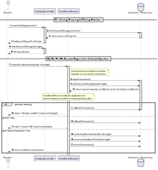
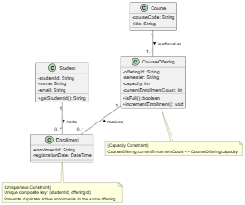
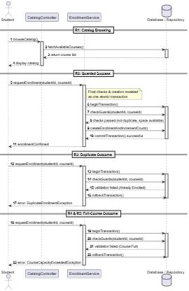
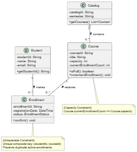

# SIS #02 — AI-Assisted UML Modeling: University Course Registration

<!--
  This is the only file you write your report in. README.md tells you what goes where.

  Rules the checker relies on:
  - Do not delete, rename or renumber the ## headings, the ### headings, or the **Label:** words.
  - Replace every "(write here)" and "(paste here)". None may be left when you submit.
  - Comments like this one are ignored by the checker and the word counter. Delete them or leave them.
-->

## 1. Scope and assumptions

<!-- Your FINAL scope statement and assumptions, after reviewing Prompt A's output. Say here
     what is out of scope (payments, prerequisites, timetable clashes, waiting lists,
     cancellation) — section 2 must not mention them. Section 10 keeps your first version. -->

**Scope:** (write here)

**Assumptions:**

1. (write here)
2. (write here)

## 2. User stories and acceptance criteria

<!-- Your APPROVED requirements: Prompt A's draft after your review. Keep the IDs, the three
     story headings and the bullet shape. Every criterion names the rule(s) it maps to,
     e.g. (R2, R4). Two criteria per story. Nothing out of scope.
     Format of a criterion, on one bullet:
     - **AC-03** (R2, R4): Given ..., When ..., Then ... -->

### US-01 — Browse offerings

**US-01:** As a signed-in student, I want to browse course offerings for a semester, so that I can see course codes, titles, offerings, and available places.

- **AC-01** (R1): Given the student is signed in and opens the catalog for a semester, When the catalog loads, Then the system shows the course code, title, offering, and available places.
- **AC-02** (R2): Given the student is viewing an offering in the catalog, When the student views its available places without submitting a registration request, Then no place is reserved for the student.

### US-02 — Register for an offering

**US-02:** As a signed-in student, I want to register for an offering with available places, so that I can enroll and receive confirmation.

- **AC-03** (R2, R4): Given the student is signed in and an existing offering has available places, When the student requests registration and the current availability is verified, Then the system creates exactly one Enrollment linking the student and offering, updates the available places count, and returns confirmation.
- **AC-04** (R2, R4): Given multiple students request the last available place at the same time, When the system performs the final availability checks and creates an enrollment, Then these actions execute atomically so that the capacity cannot be exceeded.

### US-03 — Receive a clear rejection

**US-03:** As a signed-in student, I want to receive a clear reason when registration is rejected, so that I understand why I could not enroll and my enrollment status remains unchanged.

- **AC-05** (R2, R5): Given an offering has no available places, When the student requests registration and the system rechecks availability, Then the system rejects the request with the reason "course full", creates no Enrollment, and leaves the enrollment count unchanged.
- **AC-06** (R3, R5): Given the student is already enrolled in the target offering, When the student requests registration for that same offering again, Then the system rejects the request with the reason "already enrolled", creates no Enrollment, and leaves the enrollment count unchanged.

## 3. Sequence diagram

<!-- The FINAL diagram, rendered. Change .png to .svg if that is what you exported. -->



**Participants:** (write here — each lifeline and what it stands for)

**Atomic operation:** (write here — which messages form the one atomic step: the final duplicate check, the capacity check and the creation of the Enrollment, and why a catalog view reserves nothing)

**Where the Enrollment is created:** (write here — which message, which lifeline, and which class in section 4 it produces)

**Technical lifelines:** (write here — every lifeline that is NOT a class in the class diagram, by name, and why the difference in abstraction is fine. "None" if there are none.)

## 4. Class diagram

<!-- The FINAL diagram, rendered. -->



<!-- One row per association in classes.puml, read in both directions. -->

| Association | Read left to right | Read right to left |
| --- | --- | --- |
| (write here) | (write here) | (write here) |
| (write here) | (write here) | (write here) |
| (write here) | (write here) | (write here) |

**How an Enrollment links a student to an offering:** (write here)

**Capacity constraint:** (write here — and why multiplicity alone cannot express it)

**Uniqueness constraint:** (write here — and why multiplicity alone cannot express it)

## 5. Traceability

<!-- Every rule, including the catalog fields and availability (R1). Column 1: the rule and
     the criteria that cover it, e.g. "R2 + AC-03, AC-04". Column 2: the message, guard,
     class or constraint that shows the rule in YOUR diagrams. Column 3: the T-ID that
     exercises it, or the extra check you did instead (R1 has no T case). -->

| Rule and criterion | Model evidence | Validation case |
| --- | --- | --- |
| R1 + (write here) | (write here) | (write here) |
| R2 + (write here) | (write here) | (write here) |
| R3 + (write here) | (write here) | (write here) |
| R4 + (write here) | (write here) | (write here) |
| R5 + (write here) | (write here) | (write here) |

## 6. Walkthroughs

<!-- Walk each case through YOUR final sequence diagram, message by message. Column 2: the
     actual steps and the state change (count before → after). Column 3 starts with Pass or
     Fail, then the location: the message, guard or note where you saw it. A Fail you
     report honestly is a finding, not a penalty. -->

| Case | Observed path and state change | Judgment and evidence |
| --- | --- | --- |
| T1. Available | (write here) | (write here) |
| T2. Last place | (write here) | (write here) |
| T3. Full | (write here) | (write here) |
| T4. Duplicate | (write here) | (write here) |

## 7. Review decisions

<!-- At least three substantive decisions about Prompt C's critique or your own inspection.
     Decision: accepted / rejected / modified — and what you did. Reason: why, in a full
     sentence. Rule: R1–R5. Do not invent an error to fill the table; a justified rejection
     of advice counts. -->

| AI suggestion or model element | Decision | Reason | Rule |
| --- | --- | --- | --- |
| (write here) | (write here) | (write here) | (write here) |
| (write here) | (write here) | (write here) | (write here) |
| (write here) | (write here) | (write here) | (write here) |

## 8. Modeling explanation

<!-- 200–300 words. Your main design choices; how the class diagram and the sequence diagram
     complement each other; why an activity diagram could also help explain the workflow. -->

(write here)

## 9. Reflection

<!-- 150–200 words. Written by you, not by the assistant: where AI helped, one decision you
     made yourself, one remaining limitation. Specific beats flattering. -->

(write here)

## 10. Appendix A — Before AI

<!-- Written BEFORE you run Prompt A, committed and pushed in your first commit, and never
     edited afterwards. This is what you paste into Prompt A as "My initial assumptions". -->

**Scope:** The system allows signed-in students to browse course offerings for a semester, check available places, and register for an offering while preventing registrations that exceed capacity or duplicate an existing enrollment.

**Initial assumptions:**

1. The student is already signed in, and the selected course offering exists in the system.
2. Each course offering has a positive integer capacity, and the system can determine the current number of enrolled students.

## 11. Appendix B — AI exchanges

<!-- Complete prompts and complete responses, as text — never screenshots. Paste each inside
     the ~~~~ block that follows its label: AI responses contain ``` PlantUML blocks, and
     ~~~~ keeps them from breaking this file. Prompts B and C: the prompt text first, then
     the material it refers to ("below", "these two") pasted under it, in the same block.
     You may add B5, B6 … after B4 if you ran more. -->

### B1 — Requirements (Prompt A)

- **Tool:** Gemini
- **Model:** Gemini 3.6 Flash
- **Date:** 2026-10-15
- **Purpose:** draft 3 user stories and 6 acceptance criteria

<!-- Model: the exact model with its version, as the tool shows it (e.g. "GPT-5 Thinking",
     "Claude Sonnet 4.5"). If the tool does not show it, write: not displayed
     Date: YYYY-MM-DD -->

**Prompt:**

~~~~text
Act as a requirements analyst. Use only this course registration scenario and rules R1–R5: 

A student browses an electronic course catalog, chooses a course offering and requests registration. Each offering has a limited number of places.

A Course describes a subject. A CourseOffering is one scheduled section in one semester. Registration always targets a specific offering.

Assume that the student is signed in, the selected offering exists, and its capacity is a positive whole number.

R1. Catalog: Show the course code, title, offering and available places for one semester.

R2. Capacity: Recheck current availability when registering. Enrollment must never exceed the offering's capacity.

R3. Duplicates: A student may have at most one enrollment in the same offering. Reject a repeat request.

R4. Success: Create exactly one Enrollment linking the student and offering, update availability and return a confirmation.

R5. Rejection: Explain "course full" or "already enrolled". Create no enrollment and leave the enrollment count unchanged.

These rules define this assignment. A catalog view does not reserve a place. Model the final checks and enrollment creation as one atomic operation so competing requests cannot take the same last place. A note describing the atomic operation is sufficient; database implementation is outside this assignment.

Exclude payments, prerequisites, timetable clashes, waiting lists and cancellation. Use fictional students and courses.

My initial assumptions are:
1. The student is already signed in, and the selected course offering exists in the system.
2. Each course offering has a positive integer capacity, and the system can determine the current number of enrolled students.

Draft 3 user stories and 2 Given / When / Then acceptance criteria for each. Use IDs US-01 to US-03 and AC-01 to AC-06. Map each criterion to rule IDs.
Cover normal and rejection behavior. List uncertainty separately. Do not add excluded features or invent university policies.
~~~~

**Response:**

~~~~text
Here is the requirements analysis, structured into user stories, acceptance criteria mapped to the rules, and a separate list of uncertainties based strictly on your scenario and rules.

---

## User Stories & Acceptance Criteria

### US-01: Course Catalog Browsing

**As a** signed-in student,

**I want to** browse the electronic course catalog for a specific semester,

**So that I can** view course codes, titles, available offerings, and their current available places.

* **AC-01: Display Catalog Information**
* **Given** the student is signed in and opens the electronic course catalog for a semester,
* **When** the catalog page loads,
* **Then** the system shows the course code, title, offering, and available places for one semester.
* **Rule Mapping:** R1


* **AC-02: Non-Reservation Nature of Catalog View**
* **Given** a student is viewing the available places for a course offering in the catalog,
* **When** the student browses or views the catalog details without submitting a registration request,
* **Then** no place is reserved or held for the student.
* **Rule Mapping:** R1 (Scenario Constraint)


---

### US-02: Successful Course Registration

**As a** signed-in student,

**I want to** request registration for an existing course offering with available places,

**So that** I am successfully enrolled and receive a confirmation.

* **AC-03: Successful Enrollment Creation**
* **Given** a student is signed in and selects an existing course offering with a positive number of available places,
* **When** the student requests registration and availability is successfully verified,
* **Then** the system creates exactly one Enrollment linking the student and offering, updates the available places count, and returns a confirmation.
* **Rule Mapping:** R2, R4


* **AC-04: Atomic Operation for Competing Requests**
* **Given** multiple students simultaneously request registration for the last remaining place in a course offering,
* **When** the system executes the final availability rechecks and enrollment creation,
* **Then** the process executes as a single atomic operation so that competing requests cannot take the same last place.
* **Rule Mapping:** R2, R4


---

### US-03: Registration Rejections

**As a** signed-in student,

**I want the system to** reject my registration request if the course is full or if I am already enrolled,

**So that I receive** a clear explanation and my enrollment status remains unchanged.

* **AC-05: Rejection Due to Full Capacity ("Course Full")**
* **Given** a student requests registration for an offering where the enrollment count equals or exceeds capacity,
* **When** the system rechecks availability during the atomic registration request,
* **Then** the system rejects the request, explains "course full", creates no enrollment, and leaves the enrollment count unchanged.
* **Rule Mapping:** R2, R5


* **AC-06: Rejection Due to Duplicate Enrollment ("Already Enrolled")**
* **Given** a student already has an existing enrollment in the target course offering,
* **When** the student submits another registration request for the same offering,
* **Then** the system rejects the request, explains "already enrolled", creates no enrollment, and leaves the enrollment count unchanged.
* **Rule Mapping:** R3, R5


---

## Uncertainties and Ambiguities

* **Confirmation Format:** Rule R4 mandates returning a "confirmation" upon success, but does not define its specific delivery mechanism (e.g., UI banner, modal dialog, or notification badge) or structural contents.
* **Exact Error Message Strings:** Rule R5 requires explaining "course full" or "already enrolled", but does not specify whether these exact strings must be used verbatim or if capitalization/punctuation flexibility is permitted.
* **Atomic Operation Implementation Details:** While a note describing the atomic operation is accepted and database-level implementation is excluded, the precise application-layer isolation level or locking mechanism to guarantee atomicity is unspecified.
~~~~

### B2 — UML drafts (Prompt B)

- **Tool:** (write here)
- **Model:** (write here)
- **Date:** (write here)
- **Purpose:** draft the sequence and class diagrams

**Prompt:**

~~~~text
(paste here)
~~~~

**Response:**

~~~~text
(paste here)
~~~~

### B3 — Model critique (Prompt C)

- **Tool:** (write here)
- **Model:** (write here)
- **Date:** (write here)
- **Purpose:** review both models against R1–R5 and T1–T4

**Prompt:**

~~~~text
(paste here)
~~~~

**Response:**

~~~~text
(paste here)
~~~~

### B4 — Focused revision (Prompt D)

- **Tool:** (write here)
- **Model:** (write here)
- **Date:** (write here)
- **Purpose:** apply my accepted review decisions

**Prompt:**

~~~~text
(paste here)
~~~~

**Response:**

~~~~text
(paste here)
~~~~

## 12. Appendix C — Original diagrams

<!-- The AI's first output from Prompt B, rendered unedited from models/original/. -->





## 13. Appendix D — References and source checks

### References

<!-- Full references, one per line, each starting with "- ". Only sources you actually opened.
     Every URL used in the source checks must also appear here. Example:
     - Sommerville, I. (2016). Software Engineering, 10th ed., Global Edition. Pearson. Ch. 5. -->

- (write here)

### Source checks

<!-- At least two modeling decisions you verified. Source and locator: title + slide, page,
     section, chapter or figure — or title + URL + access date (YYYY-MM-DD). Slide numbers
     refer to the decks posted in our Teams. -->

| Modeling decision | Source and locator | What the source says | How it supports or changed your model |
| --- | --- | --- | --- |
| (write here) | (write here) | (write here) | (write here) |
| (write here) | (write here) | (write here) | (write here) |
