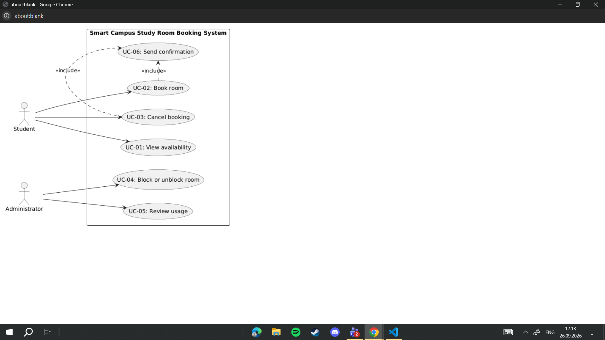

# Lab report — Practice #03, Requirements Engineering with AI

Fill in every section. **Do not delete or renumber the headings** — the README points at them and a
missing heading reads as a missing section.

Name:Amir Shadeyev
Student ID:24B030322
GitHub username:

---

## 1. Setup

| | |
| --- | --- |
| AI assistant (tool) | Google Gemini |
| Exact model name and version | Gemini 3.6 Flash 
| Date of the session | 26.09.2026 |
| Diagram renderer used | |

One tool and one model for all three prompts. If you switched, say why here — it changes what your
findings mean.

---

## 2. Original AI output — user stories (Part 1)

Paste the **unedited** response to Prompt 1. Do not tidy it. If it is long, paste all of it anyway;
this is the baseline everything else is measured against.

```
Here is the set of user stories covering all six functions (UC-01 through UC-06) for the Smart Campus — study room booking system, strictly limited to Student and Administrator actors and conforming to all stated business rules and scope limits.

User Stories
US-01: View Free Study Rooms (UC-01)
User Story: As a Student, I want to view available rooms and their open time slots, so that I can find a suitable room for my individual or group study session.

Priority: High

Assumption: Time slots are displayed in half-hour or one-hour increments up to standard operating hours.

US-02: Reserve a Study Room (UC-02)
User Story: As a Student, I want to book an available room for a selected future time slot of up to two hours, so that I can guarantee space to study without conflict.

Priority: High

Assumption: Selecting a booking window of exactly two hours (e.g., 10:00 AM to 12:00 PM) is permitted and considered valid under R2.

US-03: Cancel an Existing Reservation (UC-03)
User Story: As a Student, I want to cancel a reservation I previously made, so that the room becomes available again for other students if my plans change.

Priority: Medium

Assumption: Students can only cancel active or future reservations that they personally created.

US-04: Block a Room from Service (UC-04)
User Story: As an Administrator, I want to block a study room from being booked, so that students cannot reserve space that is temporarily unavailable.

Priority: High

Assumption: Blocking a room immediately prevents new bookings from being created for that room during the blocked period.

US-05: Unblock a Room for Service (UC-04)
User Story: As an Administrator, I want to unblock a previously blocked room, so that students can resume reserving it once it is available again.

Priority: Medium

Assumption: Unblocking a room returns it to standard availability status for future time slots.

US-06: Review Room Usage Reports (UC-05)
User Story: As an Administrator, I want to review room reservation metrics and usage history over a specified time period, so that I can monitor library room utilization patterns.

Priority: Low

Assumption: Usage reporting aggregates past booking data without relying on check-in or hardware monitoring data.

US-07: Automated Confirmation Delivery (UC-06)
User Story: As a Student, I want to receive an automated confirmation message whenever I make or cancel a booking, so that I have immediate proof of my reservation status.

Priority: High

Assumption: Confirmation delivery occurs within the web application interface immediately following a booking or cancellation action.
```

---

## 3. Story review (Part 2)

One row per change you made. "Kept unchanged" is a valid row and needs a reason too.

| Story (as generated) | What I did | Why | Final ID |
| US-01: View Free Study Rooms | Rewrote the assumption | The generated assumption invented half-hour/one-hour increments and standard operating hours, which are not specified in the scenario. | US-01 |
| US-02: Reserve a Study Room | Kept with minor wording refinement | The story matches the Student role and booking goal. The assumption also settles the two-hour boundary. | US-02 |
| US-03: Cancel an Existing Reservation | Rewrote the assumption | “Active or future reservations” is not defined by the scenario. | US-03 |  
| US-04: Block a Room from Service | Rewrote the reason and assumption | “Immediately” and the exact blocking period add timing details not defined in the scenario. | US-04|
| US-05: Unblock a Room for Service | Kept as a separate story and rewrote the assumption | Blocking and unblocking are separate administrator goals, while both trace to UC-04. The generated assumption about “standard availability status” was too implementation-specific. | US-05|
| US-06: Review Room Usage Reports | Rewrote the goal, reason, and assumption | “Metrics,” “usage history,” and references to check-in or hardware monitoring add details not present in the scenario. | US-06 |
| US-07: Automated Confirmation Delivery | Rewrote the story and assumption | “Automated message” and “web application interface” add details about implementation and screens that are out of scope. | US-07 |

The AI assistant did not invent any new actor, but several generated assumptions added details that were not specified in the scenario. These included time-slot increments, operating hours, active/future reservation states, immediate blocking behavior, usage metrics, check-in or hardware monitoring, automated messages, and a web application interface. These details were removed during review.

I kept seven user stories. US-04 and US-05 remain separate because blocking and unblocking a room represent different administrator goals, while both trace to UC-04. All final stories use Student or Administrator as the stakeholder, describe a single valuable outcome, remain within the supplied scenario, and can be tested against the requirements.


**Did the assistant invent anything outside the scenario?** Name it against the out-of-scope list in
README section 1, or write "no, and here is how I checked".
Yes. The assistant added several details that were not specified in the scenario or were explicitly outside the scope. These include half-hour or one-hour time slots and standard operating hours, active/future reservation states, usage metrics and usage history, check-in or hardware monitoring, automated confirmation messages, and a web application interface. The last two also introduce implementation/interface details that are outside the scope. These details were removed during review.
**How many stories did you end with, and why that number?**
I ended with seven user stories. This is within the required range of 6–8 stories. The six required use cases are covered, while UC-04 has two stories because blocking and unblocking a room represent two distinct Administrator goals. No additional stories were created for functionality outside the supplied scenario.
---

## 4. Original AI output — acceptance criteria (Part 3)

```
Here are the acceptance criteria in **Given-When-Then** format for all system use cases, adhering strictly to the scenario boundary, business rules, and established architectural decisions.

---

## Architectural & Scenario Assumptions

1. **R1 (Future Start):** Start time must be strictly greater than the current system timestamp ($t_{\text{start}} > t_{\text{now}}$).
2. **R2 (Maximum Duration):** Bookings up to and including **exactly 2 hours** (120 minutes) are valid ($\Delta t \le 2\text{ hr}$).
3. **R3 (Overlap Rule):** Time slots are treated as half-open intervals $[t_{\text{start}}, t_{\text{end}})$. A booking ending exactly when another begins (e.g., 10:00–12:00 and 12:00–14:00) is **allowed** and not considered an overlap.
4. **R4 (Blocked Status):** Rooms set to "Blocked" reject all new booking attempts regardless of student request parameters.

---

## Acceptance Criteria

### UC-01: View Availability

* **Scenario 1: Successful display of room schedules**
* **Given** a Student or Administrator is viewing the booking interface for a selected date
* **When** they request room availability for that date
* **Then** the system displays all library study rooms along with their status (Free, Booked, or Blocked) across all time slots.


* **Scenario 2: Visual distinction of blocked rooms**
* **Given** Room 101 has been marked as "Blocked" by an Administrator for the full day
* **When** a Student checks room availability for that day
* **Then** Room 101 is explicitly shown as unavailable for all time slots with no option to select it for booking.


* **Scenario 3: Viewing past dates (Validation/Alternative)**
* **Given** a Student selects a date prior to today
* **When** they submit the search query
* **Then** the system displays historical slot statuses in read-only mode and disables all booking actions.


---

### UC-02: Book Room

* **Scenario 1: Successful booking creation**
* **Given** Room 102 is free tomorrow from 14:00 to 16:00
* **When** a Student submits a booking request for Room 102 starting tomorrow at 14:00 and ending at 16:00
* **Then** the system creates the reservation, updates Room 102 status to Booked for that interval, and triggers **UC-06** to send a booking confirmation.


* **Scenario 2: Reject booking exceeding maximum duration (R2 Validation)**
* **Given** Room 102 is free tomorrow from 10:00 to 13:00
* **When** a Student attempts to book Room 102 from 10:00 to 12:01 (2 hours and 1 minute)
* **Then** the system rejects the booking request with an error stating that bookings cannot exceed two hours.


* **Scenario 3: Reject booking starting in the past (R1 Validation)**
* **Given** the current time is today at 11:00 AM
* **When** a Student attempts to book a free room for today from 09:00 to 10:30
* **Then** the system rejects the request with an error stating that bookings must start in the future.


* **Scenario 4: Reject booking on an overlapping time slot (R3 Error)**
* **Given** Room 103 is already booked tomorrow from 13:00 to 15:00
* **When** another Student attempts to book Room 103 tomorrow from 14:00 to 15:30
* **Then** the system rejects the request with an error stating the selected room is already reserved for that period.


* **Scenario 5: Allow adjacent boundary booking (R3 Boundary Rule)**
* **Given** Room 103 is booked tomorrow from 13:00 to 15:00
* **When** a Student submits a booking request for Room 103 tomorrow starting at 15:00 and ending at 17:00
* **Then** the system accepts the booking, creates the reservation, and triggers **UC-06** confirmation.


* **Scenario 6: Reject booking on a blocked room (R4 Error)**
* **Given** Room 104 is currently set to "Blocked" by an Administrator
* **When** a Student attempts to book Room 104 for a valid future time slot of 1 hour
* **Then** the system rejects the booking attempt with an error stating the room is out of service.


---

### UC-03: Cancel Booking

* **Scenario 1: Successful cancellation**
* **Given** a Student has an active reservation for Room 101 tomorrow from 10:00 to 12:00
* **When** the Student submits a request to cancel this booking
* **Then** the system removes the reservation, marks the time slot as free, and triggers **UC-06** to send a cancellation confirmation.


* **Scenario 2: Reject cancellation of past or expired bookings (Validation)**
* **Given** a Student had a reservation for Room 101 that ended yesterday
* **When** the Student attempts to perform a cancellation action on that past reservation
* **Then** the system prevents the operation and displays a message stating past bookings cannot be cancelled.


* **Scenario 3: Attempting to cancel an already cancelled reservation (Error Case)**
* **Given** a reservation was already cancelled in a prior action
* **When** a cancellation request is submitted again for the same booking identifier
* **Then** the system returns an error indicating the reservation is no longer active.


---

### UC-04: Block or Unblock Room

* **Scenario 1: Successfully blocking an operational room**
* **Given** Room 105 is currently unblocked
* **When** an Administrator sets the status of Room 105 to "Blocked"
* **Then** the system updates Room 105 state to Blocked and prevents any subsequent booking attempts on it (**R4**).


* **Scenario 2: Successfully unblocking a room**
* **Given** Room 105 is currently in "Blocked" status
* **When** an Administrator submits a request to unblock Room 105
* **Then** the system restores Room 105 to operational status, allowing it to appear as free for future valid time slots.


* **Scenario 3: Blocking a room with existing future bookings (Alternative/Conflict Handling)**
* **Given** Room 105 has an active student booking tomorrow from 11:00 to 12:00
* **When** an Administrator blocks Room 105 for tomorrow
* **Then** the system marks the room as blocked and automatically cancels the conflicting future reservation, triggering **UC-06** cancellation confirmation to the affected student.


---

### UC-05: Review Usage

* **Scenario 1: Successful generation of utilization report**
* **Given** room bookings have occurred over the past week
* **When** an Administrator selects a date range covering the past week and requests a usage summary
* **Then** the system displays the total booked hours, number of reservations, and room utilization breakdown for that timeframe.


* **Scenario 2: Report query with no booking data (Alternative Case)**
* **Given** no study rooms were booked on a specific holiday date
* **When** an Administrator generates a usage review for that holiday date
* **Then** the system returns a utilization report displaying zero booked hours and zero total reservations without throwing an error.


* **Scenario 3: Invalid date range input (Validation)**
* **Given** an Administrator enters a range where the end date precedes the start date
* **When** they submit the report request
* **Then** the system blocks the request and displays an error message requiring a valid chronological date range.


---

### UC-06: Send Confirmation

* **Scenario 1: Send booking confirmation notice**
* **Given** a Student has successfully completed a booking (**UC-02**) for Room 101 tomorrow from 09:00 to 11:00
* **When** the reservation process completes
* **Then** the system generates and dispatches a confirmation notice containing Room 101, date, and 09:00–11:00 time details to the Student.


* **Scenario 2: Send cancellation confirmation notice**
* **Given** a Student has successfully cancelled an active booking (**UC-03**)
* **When** the cancellation process completes
* **Then** the system generates and dispatches a cancellation notice confirming the release of the reserved room and time slot to the Student.


* **Scenario 3: Notice trigger handling on system failure (Error Case)**
* **Given** a booking request (**UC-02**) fails validation due to an overlapping schedule (**R3**)
* **When** the booking action is rejected
* **Then** the system does not trigger or send any confirmation notice.
```

---

## 5. Criteria review (Part 3)

| Criterion (as generated) | Problem | What I changed it to | Final ID |
| UC-02 Scenario 1: Successful booking creation | The criterion adds specific room numbers, status changes, and a confirmation trigger. The business requirement only needs successful booking behavior and confirmation. | Given a Student selects an available room and a future time slot of no more than two hours, When the Student submits the booking, Then the system creates the booking and confirms the booking. | AC-01 |
| UC-02 Scenario 2: Reject booking exceeding maximum duration | The criterion is consistent with R2, but the exact error message is an unnecessary interface detail. | Given a requested booking is longer than two hours, When the Student submits the booking, Then the system rejects the booking. | AC-02 |
| UC-02 Scenario 3: Reject booking starting in the past | The criterion correctly tests R1, but the exact error message is an unnecessary interface detail. | Given the booking start time is not in the future, When the Student submits the booking, Then the system rejects the booking. | AC-03 |
| UC-02 Scenario 4: Reject booking on an overlapping time slot | The criterion correctly tests R3. The specific room number and error message are unnecessary details. | Given another booking already occupies part of the requested time interval, When the Student submits the booking, Then the system rejects the booking. | AC-04 |
| UC-02 Scenario 5: Allow adjacent boundary booking | The criterion correctly covers the selected R3 boundary decision. Specific room numbers and confirmation details are unnecessary. | Given one booking ends exactly when another booking begins, When a Student submits the second booking, Then the system allows the second booking because the intervals do not overlap. | AC-05 |
| UC-02 Scenario 6: Reject booking on a blocked room | The criterion correctly tests R4, but “error stating the room is out of service” is an unnecessary interface detail. | Given a room is blocked, When a Student attempts to book it, Then the system rejects the booking. | AC-06 |
| UC-03 Scenario 1: Successful cancellation | The criterion is mostly consistent, but it uses an “active reservation” concept that was not defined as a business rule. | Given a Student has a reservation they made, When the Student cancels it, Then the system releases the reservation and confirms the cancellation. | AC-07 |

**The two open questions.** Write your decision and the reason. Either answer is accepted.

| Question | My decision | Why |
| --- | --- | --- |
| A booking ending exactly when another begins — overlap under R3? | not-allowed | I decided that adjacent bookings do not overlap. Therefore, if one booking ends exactly when another begins, both bookings are allowed. |
| Is exactly two hours allowed under R2? | allowed | I decided that the maximum duration is inclusive, so a booking lasting exactly two hours is valid. |

**Which invalid or boundary case did the assistant leave out?**
The assistant covered the main R1–R4 booking validation cases, including a booking starting in the past, a duration exceeding two hours, an overlapping booking, and a blocked room. However, it did not provide a clean boundary criterion for exactly two hours. The generated criteria state that exactly two hours is allowed in the assumptions, but the acceptance criteria do not explicitly test the two-hour boundary. I added this boundary to AC-01 by allowing a booking of no more than two hours.

---

## 6. Original AI output — use-case diagram (Part 4)

```
@startuml SmartCampus_UseCaseDiagram
left to right direction
skinparam packageStyle rectangle

actor "Student" as student
actor "Administrator" as admin

rectangle "Smart Campus Study Room Booking System" {
  usecase "UC-01: View availability" as UC1
  usecase "UC-02: Book room" as UC2
  usecase "UC-03: Cancel booking" as UC3
  usecase "UC-04: Block or unblock room" as UC4
  usecase "UC-05: Review usage" as UC5
  usecase "UC-06: Send confirmation" as UC6
}

' Actor Associations
student --> UC1
student --> UC2
student --> UC3

admin --> UC4
admin --> UC5

' Dependencies
UC2 .> UC6 : <<include>>
UC3 .> UC6 : <<include>>

@enduml
```

Rendered diagram (image, or a link):

---

## 7. Diagram review (Part 4)

| Element | Problem | What I changed |
| --- | --- | --- |
| Student associations | No problem. Student is associated with View availability, Book room, and Cancel booking as required by the scenario. | Kept unchanged. |
|Administrator associations | No problem. Administrator is associated with Block or unblock room and Review usage as required by the scenario. | Kept unchanged. |
| UC-02 -> UC-06 | The relationship needs to be checked because Send confirmation is performed by the system rather than directly by a person. |
Kept <<include>> because a successful booking requires the system to confirm the booking. |
| UC-03 -> UC-06 | The relationship needs to be checked because Send confirmation is performed by the system rather than directly by a person. | Kept <<include>> because a successful cancellation requires the system to confirm the cancellation. |
| System boundary | No problem. All six required use cases are inside the system boundary. | Kept Unchanged |
| Actors | No problem. Only Student and Administrator are shown outside the system boundary. | Kept unchanged |

**Associations.** Which actor–use-case links did the assistant draw that a person does not actually
trigger? Name them.
The assistant did not draw any actor–use-case association that a person does not actually trigger. Student is associated with viewing availability, booking, and cancelling. Administrator is associated with blocking or unblocking rooms and reviewing usage. Send confirmation is not directly associated with either actor; instead, it is included by Book room and Cancel booking because the system performs the confirmation after those actions.

**Did any screen, database or internal component appear as a use case or an actor?**
No. The diagram does not contain screens, databases, servers, or internal components as actors or use cases.

---

## 8. Traceability (Part 5)

Summarise what the table in `requirements/traceability.md` shows:

- Use cases with **no story** behind them:none
- Stories with **no use case** they belong to:none
- Criteria that test **no rule** from section 1:AC-01,AC-07

**What does the largest gap tell you about the generated requirements?**
The largest gap is that four use cases — UC-01, UC-04, UC-05, and UC-06 — do not have direct acceptance criteria in the selected criteria set. This is because the task required acceptance criteria for only three selected stories. All six use cases are still covered by user stories, so the main traceability gap is acceptance-criteria coverage rather than missing requirements.
---

## 9. Checker runs

Paste the **real terminal output** of both runs. A table with nothing behind it does not count.

```
$ python tests/check_requirements.py
PASS   US-1  user-stories.md         no placeholders left
PASS   US-2  user-stories.md         7 stories, IDs US-01…US-07
PASS   US-3  user-stories.md         every story has the required sentence shape
PASS   US-4  user-stories.md         every story has a priority
PASS   US-5  user-stories.md         every story declares an assumption
PASS   US-6  user-stories.md         only Student and Administrator appear as roles
PASS   US-7  user-stories.md         nothing from the out-of-scopelist appears
PASS   AC-1  acceptance-criteria.md  no placeholders left
PASS   AC-2  acceptance-criteria.md  three sections, all naming real stories: US-02, US-03, US-04
PASS   AC-3  acceptance-criteria.md  every section has 3 to 5 uniquely numbered criteria
PASS   AC-4  acceptance-criteria.md  all 9 criteria are complete Given/When/Then
PASS   AC-5  acceptance-criteria.md  every section covers an invalid or boundary case
PASS   AC-6  acceptance-criteria.md  3 assumptions listed before the criteria
PASS   AC-7  acceptance-criteria.md  both open questions are settled in the assumptions
PASS   PU-1  use-cases.puml          valid PlantUML block, no placeholders
PASS   PU-2  use-cases.puml          exactly two actors: Student, Administrator
PASS   PU-3  use-cases.puml          all six use cases present
PASS   PU-4  use-cases.puml          system boundary present
PASS   PU-5  use-cases.puml          no screens, databases or internal components
PASS   PU-6  use-cases.puml          no unjustified actor associations found
PASS   TR-1  traceability.md         all six use cases have a row
PASS   TR-2  traceability.md         every ID in the table resolvesPASS   TR-3  traceability.md         every story appears in the table
------------------------------------------------------------------------
23 PASS · 0 FAIL · 0 ERROR   (23 checks)
Shape is clean. This says nothing about whether the requirements are good.
```

```
$ python tests/validate_submission.py
(paste)
```

| | PASS | FAIL | ERROR |
| --- | --- | --- | --- |
| `check_requirements.py` | | | |

Commit these numbers were produced at (`git rev-parse --short HEAD`):

**Every FAIL, one line each: what it is and what you decided to do about it.** A FAIL you report and
explain costs you nothing.

**Did you run the checks by hand instead of with Python?** Say so here — it costs nothing, but it
has to be said.

---

## 10. Conclusion (150–200 words)

Answer all three:

1. Which part of the generated requirements was most wrong, and how would you have caught it without
   a checker?
2. What did the assistant get right that would have taken you noticeably longer by hand?
3. You are handing these requirements to someone who will implement them, and you will not be in the
   room. Which single one would you rewrite first, and why?

Be specific. "The AI was useful" is worth nothing; "UC-06 had no story behind it until I wrote
US-07, and the checker is what told me" is worth everything.
